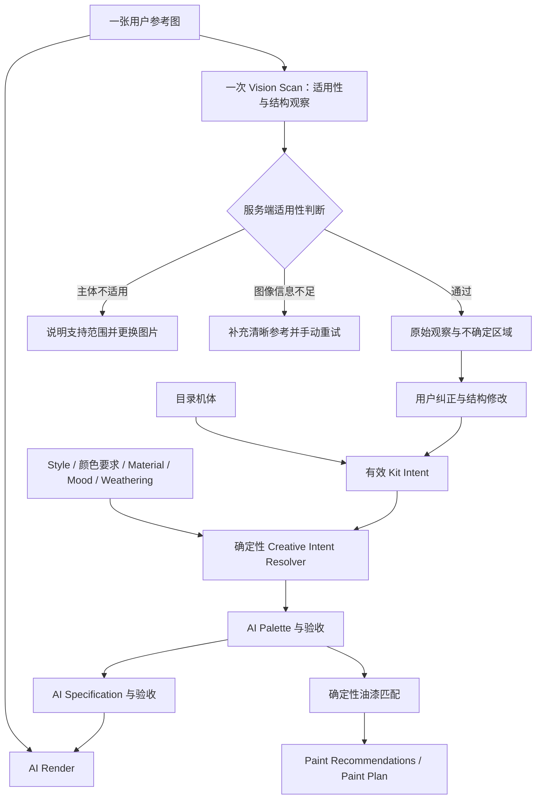

# Custom Kit：参考图扫描与开放机体创作评估

日期：2026-10-11
状态：架构评估与建议，尚未实现；没有执行付费模型调用或部署。
关联方案：[Creative Intent Resolver 与配色契约升级](./creative-intent-resolver-upgrade.md)。
统一执行顺序：[Style 与 Custom Kit 升级执行计划](./creation-upgrade-execution-plan.md)。

本次确认的首版范围：**一张用户机体参考图 + 文本描述**；Custom Kit 与官方目录 Kit 分开；扫描同时判断输入是否适用于机体创作。双参考图、donor 部件图与多图融合暂不实施，待单图效果验证后再评估。

## 1. 目标与结论

审核反馈指出，用户无法上传自己的机器人或直接创建机器人，只能使用平台预置目录。本方案优先开放用户上传的机体参考图，并允许有明确范围的结构修改，使创作不再依赖已有机体目录。

建议采用：用户上传一张图 → 一次多模态扫描（适用性判断 + 结构观察）→ 服务端适用性拦截 → 用户纠正与文本结构修改 → 有效 Kit Intent → 共用的 Palette / Specification / Render 管线。

扫描是一次普通模型请求，不新增 Agent、工具调用循环、多模型协作或新的任务编排框架。现有 Cloudflare 图像路线可承担参考图生成；Kit Intent JSON 由支持图像理解和结构化文本输出的模型负责。

这一架构可以支持用户上传与局部自定义，是否满足审核方的全部要求仍需对方判断。纯文本从零创建可以后续加入同一 Kit Source 抽象，不应把首版上传功能描述成已经具备纯文本创建能力。

产品范围以动漫机甲、机器人及其模型、线稿和概念图为主。适用性根据可见机体结构判断，不要求图片属于已知 IP 或命中现有目录；无法识别出作品名不应阻止原创机体进入 Custom Kit。

## 2. 当前已有能力与缺口

本次核对依据为当前仓库实现与 2026-10-11 查阅的官方文档，不是对生产部署的端到端验证。

| 能力 | 当前状态 | 接入 Custom Kit 的要求 |
| --- | --- | --- |
| 参考图传给 Cloudflare | 已实现，`cloudflareImageRequest` 支持 `input.images` | 复用请求协议，增加用户参考图来源 |
| 机体几何参考 | 从目录机体 `fullBodyAssetKey` 取得线稿 | 支持私有、属于当前用户的参考资产与冻结版本 |
| 图像权威规则 | 图像与文字几何冲突时图像优先 | 修改为参考约束未修改区域，明确的局部编辑优先 |
| Vision Scan | 本次未找到用户机体结构扫描流程 | 新增有 Schema 的扫描阶段与结果保存 |
| 输入适用性判断 | 本次未找到 Custom Kit 的机体类别拦截 | 与结构观察共用一次扫描，服务端决定能否继续 |
| 文本调用 | `userPrompt` 为字符串，使用 `json_object` | 增加图像 content parts 与 Schema 输出能力 |
| Vision 配置 | Provider capability 枚举有 `vision` | 枚举存在不代表已接通执行路由或验证模型能力 |
| 创作输入 | 必须选择有效目录机体 | 允许 catalog / user-upload 来源，不创建伪目录机体绕过校验 |
| 持久化与编排 | 已有媒体资产、R2 生命周期、Convex Workflow | 扩展现有基础设施，不引入新框架 |
| 参考失败降级 | 参考图加载失败时继续纯文本生成 | Custom Kit 的必需参考失败时停止并可重试，不静默忽略 |

主要代码证据：

- `convex/shapeReference.ts`：当前参考指令明确假定官方、无颜色线稿，并规定形状冲突时图像优先。
- `convex/llmProtocol.ts`：Cloudflare 图像请求支持图片数组；`requestTextCompletion` 尚不接收图像或 JSON Schema。
- `convex/generation.ts`：参考来自目录 `baseModel.fullBodyAssetKey`。
- `convex/generationNode.ts`：图像协议决定是否使用参考；加载失败时可继续纯文本。
- `convex/creativePipeline.ts`、`convex/prototypes.ts`：Palette 与 Specification 要求有效目录机体。
- `convex/creationWorkflow.ts`：现有主生成工作流执行 Palette、Specification、Render 三阶段。

不能把已有形状参考支持称作已经拥有 Kit Scan。

## 3. 模型与 API 能力核对

### Cloudflare 图像生成

当前项目主路线为 `openai/gpt-image-2.5-sunburst`，与 LLMRelay 的 `gpt-image-2` 是不同的模型 ID 和接口适配器。

[Cloudflare Sunburst 文档](https://developers.cloudflare.com/ai/models/openai/gpt-image-2.5-sunburst/) 明确支持文本与图像输入。`images` 可包含 1–16 个 Base64 图像，生成结果为图片 URL。现有项目已按该请求方式实现参考图输入。**首版产品只允许一张参考图**；API 的多图容量不构成首版功能范围。文档支持能力判断，但不能代替本项目输入上的生成质量验证。

当前 LLMRelay 适配器使用 `/images/generations`，本项目尚未实现该路线的 `/images/edits`。不能因为底层模型支持编辑，就认为每条当前路线都会接收参考图。

### 结构扫描与 JSON

[OpenAI GPT Image 2 文档](https://developers.openai.com/api/docs/models/gpt-image-2) 与 [Sunburst 文档](https://developers.openai.com/api/docs/models/gpt-image-2.5-sunburst) 均将文本列为仅输入，并明确不支持 Structured Outputs。因此不建议用这两条图像路线生成 Kit Intent JSON。

接口响应的 JSON 外壳是图片及请求元数据，不等于对机体的结构化理解输出。

[Gemini OpenAI 兼容文档](https://ai.google.dev/gemini-api/docs/openai) 包含 `image_url` 图像理解与结构化 JSON 示例；[结构化输出文档](https://ai.google.dev/gemini-api/docs/structured-output) 描述 JSON Schema 能力。建议优先验证现有 Gemini 提供商是否能复用，实施时验证具体模型 ID、图像输入与 Schema 的组合，不因现有文本请求可用而直接宣称 Vision 路径已经验证。

扫描应使用明确的 Kit Scan Schema，并在服务器再次验证。JSON 合法不证明观察正确，用户纠正仍然必要。

## 4. 与 Resolver 的统一架构

目录机体通过适配器转成相同的 Kit Intent。自定义机体来自参考资产、扫描和用户编辑。二者共用下游，不长期维护两个独立创作管线。

Resolver 分别处理几何、颜色、材质、图案、情绪和旧化约束。参考图的几何约束和 Style 的配色约束可以同时生效，没有一个对所有属性都适用的“图像权重”。

扫描可作为主生成前的独立准备步骤，保存完成后由用户检查，再进入已有三阶段 Workflow。这样支持人工纠正，并避免把等待用户操作塞入主生成工作流。

### 4.1 Official Kit 与 Custom Kit 的身份边界

这里的 Official Kit 指平台维护的官方目录条目。Custom Kit 是用户拥有的独立创作输入，不能通过创建伪目录条目或挂靠默认机体来绕过当前的目录校验。

| 属性 | Official Kit | Custom Kit |
| --- | --- | --- |
| 来源 | 平台维护的目录机体 | 当前用户上传的单张参考及文本 |
| Kit Source | `kind: "catalog"`，引用目录 Kit ID | `kind: "custom"`，引用 Custom Kit ID 与版本 |
| 结构依据 | 目录 Model DNA 与目录参考图 | 扫描观察、用户纠正与结构修改 |
| 身份与版本 | 目录条目及冻结快照 | 用户归属、参考资产版本、Kit Intent 版本 |
| 产品标识 | Official Kit / 目录名称 | Custom Kit / 用户自定义名称 |
| 目录关系 | 具有已维护的 IP 与机体关联 | 不强制 IP、目录匹配或官方机体 ID |

即使扫描认为图片类似某个已知 IP 机体，上传仍保持 Custom Kit 身份。名称猜测不应替换结构观察，也不自动变成官方目录来源。

创建入口、生成记录、Library 详情和发布的创作应保留来源标识。Custom Kit 可以使用官方 Style 预设，也可以按产品发布流程分享创作，但不会自动产生官方 Kit 条目、IP 关联或官方目录 SEO 页面。发布生成结果不自动公开原始参考图。

### 4.2 输入适用性拦截

适用性是产品能力判断，与内容安全审核分别记录。首版让同一次 Vision Scan 输出 `eligibility` 与结构观察，不另加一次分类模型调用，也不引入 Agent。

`eligibility` 的建议最小字段：`status`、`subjectType`、`reasonCode`、观察依据。模型判断由服务端校验后用于拦截，客户端不能通过修改结果或文本声明自行放行。

| 状态 | 含义 | 后续行为 |
| --- | --- | --- |
| `supported` | 有可辨认的目标机体和足够可见结构，可支撑首版涂装规划 | 展示扫描结果，进入纠正与修改 |
| `unsupported` | 主体明显不是当前支持的机体 | 停止，不生成 Kit Intent 部件、Palette、Specification 或 Render |
| `needs-better-reference` | 主体可能适用，但模糊、过小、遮挡严重或主机体不明确 | 请求更清晰或更聚焦的替代图片，不自动生成或反复扫描 |

支持与拦截应以可见结构为依据：

- 动漫机甲、机器人、机甲模型、原创机器人线稿或概念图可以进入评估；不要求知名角色、金属材质或人形外观。
- 猫狗等真实动物照片、普通动物插画，以及没有机体结构的无关主体，在当前范围外。
- 动物形机甲、四足机器人不能因为外形像动物而直接拒绝；具有可辨认机体部件的兽形机甲仍可适用。其部件分组也不能被强制改成人形。
- 只有普通动漫人物、风景、日用品，且无目标机体结构时，按不适用处理。
- 看不清的机器人图与明确的小动物图片采用不同结果，避免把信息不足误报为不支持。
- 背面连接不可见属于局部不确定性；只要主体与可见部件足够，不因单张图未展示背面而一概拒绝。
- 图片包含小动物背景但主机体清晰时，依据主机体判断，不因背景元素机械拦截。

不要求模型先完整描述不适用主体，再尝试把它强行改成机器人。明确不适用时，观察列表可为空并附原因；首版不提供“把小动物变成机甲”的转换流程。用户文本可以辅助解释结构，但不能将明显不适用图片改写为扫描已通过。

提示应直接说明范围与下一步，例如“不支持这张参考图。请上传机甲或机器人模型的照片、线稿或概念图”，或“机体细节不够清晰，请换一张主体更完整、清晰的图片”。不要求用户重新选择官方目录机体。

适用性通过记录绑定参考资产版本与扫描版本。修改或替换图片后旧结论失效；扫描超时、输出无效或不确定时不得默认放行。局部文本编辑通常不必重扫原图，但不能将范围外主体或改造请求通过文本绕过产品边界。

拦截发生在主生成及其扣费之前。扫描本身的定价和失败计费规则另行确定，不将这个安排描述成扫描免费。适用性误判需要通过样本验证与规则/模板版本修正处理，不把未校准的模型置信分数直接当成可靠阈值。

## 5. Kit Intent 的最小契约

用户提出的轻量 Schema 方向正确，但建议按语义分开五部分：

| 部分 | 含义 | 原则 |
| --- | --- | --- |
| `observations` | 原始参考图中观察到的结构 | 扫描快照保持不可变 |
| `corrections` | 用户纠正识别错误 | 不等于想改变机体 |
| `requestedEdits` | 用户希望改变的结构 | 记录目标部位、动作与来源 |
| `preserveConstraints` | 编辑范围外需要保留的结构 | 不与已批准的局部编辑相互抵消 |
| `uncertainFeatures` | 部分可见、遮挡或未展示的细节 | 不补全为观察事实 |

在扫描输出中另有 `eligibility`；只有服务端确认通过，观察才可进入有效 Kit Intent。增加契约版本、Custom Kit 身份、参考资产/版本引用和稳定部件 ID。可用 `parts[]` 表达部件组，而不要求固定字段全部有值。每个部件至少有 ID、类别、描述、可见状态和参考来源。

第一版考虑头、胸、肩、手臂、腿、背包、武器和可见骨架等部件组，以支撑后续 Paint Plan；兽形或非人形机体使用适合其结构的部件组。只记录可见内容，不强制扫描填满所有部件。

可见状态可以区分 `visible`、`partial`、`not-visible`；未知值允许为空。未展示的背包连接结构不能因为识别出某个知名机体而写入观察记录。

例如，“扫描把盾牌识别成背包”属于 correction；“将盾牌换成更大的盾牌”属于 requested edit。保留原始观察后，应用纠正得到有效基线，再在该基线上表达修改意图。

自由文本的归一化也需要边界：已有扫描不必因文本修改重新执行，但任意自然语言转成结构编辑并不是确定性工作。第一版可使用“部件 + 动作 + 补充描述”输入；开放任意描述时复用已有文本理解阶段或明确支持范围，不能承诺仅靠规则准确理解所有修改。

不要求 CAD 数据、精确尺寸、自动关节推理、完整装配关系或面板级分割。

## 6. 几何与颜色的权限

| 属性 | 默认依据 | 显式用户要求的作用 |
| --- | --- | --- |
| 未编辑的机体结构 | 参考图观察及用户纠正 | 默认保留 |
| 指定部位结构修改 | `requestedEdits` | 在该范围内优先于原始形状 |
| 原始配色 | 不自动进入有效配色约束 | 明确要求保留时才加入相应约束 |
| 最终颜色 | Resolver 处理后的颜色要求与 Style | 用户明确颜色覆盖风格默认 |
| 材质与旧化 | 有效材质、旧化契约 | 不从参考照片默认继承 |
| 未展示结构 | 未知 | 避免当成事实，必要补全必须标注为生成假设 |

当前 `SHAPE_REFERENCE_DIRECTIVE` 不能原样复用：上传照片可能已经有颜色，不一定是官方线稿，也不一定是目录中的现有机体。

“保留原始轮廓”与“增大肩甲”会影响同一属性，应改为“未授权区域保持，肩甲按请求修改”，而不是同时添加两个全局强指令。

局部修改只放宽该部位及完成修改所必需的邻接范围，不自动授权重设计头部、腿部或整台机器人。扩展背包翼片也可能改变外轮廓，不能继续使用无条件的全局轮廓锁。

第一版默认尽量沿用参考视角。单张正面图不足以支持对背面细节的准确恢复；多角度生成应明确其不可确认部分，而非把生成补全描述为实物结构。

Cloudflare 所列输入参数没有可分别设置几何与颜色的数值权重。这里的权重应先通过契约、区域范围和提示词裁决表达；控制效果仍需用实际样本验证。

## 7. 首版单图加文本；双图部件迁移暂缓

首版只接收一张 A 机体参考图，用户可以用文本描述希望加入或修改的武器、背包等部件。A 是有图像证据的基础结构；新增部件来自用户要求与生成提案，适合概念创作，不能冒充扫描观察，也不能承诺精确复现未提供参考的 B。

例如“给它加入 B 风格的武器”仍通过单图加文本处理，不能将模型对 B 的印象写成从上传图中观察到的事实。用户写明部件形状、数量、安装位置等，可以提高修改要求的明确程度。

**首版不接收第二张 donor 图，不实现多图扫描、融合或精确部件迁移，也不提供相关入口。** 先验证单图加文本的生成效果，再决定是否扩展。

未来若引入 A+B，需明确 A 为主体、B 为指定部件参考，并限定 B 的影响范围、记录观察来源；Cloudflare 的多图能力仅作为未来扩展基础。该工作不属于首版验收或前置依赖。

## 8. Paint Plan 的职责与限制

顺序继续为 Palette → Specification → Render。Paint Plan 与油漆推荐来自批准的颜色和部件分配，不由图像模型从成图反向生成。

Specification 应依据有效 Kit 的部件组分配颜色，避免继续使用目录机体特有的固定部位描述。多种装甲颜色由新版颜色/assignment 契约承接。

结构修改后的颜色和喷涂部位建议可以复用，但“肩甲加厚”“武器替换”涉及实体改造。图像结果不能证明零件尺寸、连接结构或实体改造可行，也不自动等于装配指导。界面应说明生成的是概念效果与涂装建议，具体改造工艺需另行确认。

## 9. 上传与运行基础设施

复用现有私有 R2、媒体资产、版本与生命周期体系：

- 参考资产按当前用户授权，扫描与生成入口验证所有权。
- 存储资产 ID、版本与校验信息；短期签名读取地址在执行时生成，不把长期公开 URL 作为参考身份。
- 参考文件的实际格式、大小、尺寸与可解码性在进入生成前检查。
- 首版服务端限制恰好一张参考图；适用性通过结果须与当前用户、参考版本和 Kit Intent 绑定。
- 生成冻结 Kit、参考版本、编辑与 Resolver 版本；后续更改不影响历史作品。
- 扫描可按参考内容、模型和模板版本复用；修改 Style 或文字编辑不自动重扫原始图片。
- Kit Scan 的计费、重复请求、失败与重试沿用现有账本和幂等模式，价格另行确定。
- 私有参考不因发布生成结果而自动公开；删除与保留行为接入既有资产生命周期。
- 现有提示文本安全筛查必须覆盖新扫描和编辑入口；上传图像的审核能力另行核实，不能将当前文本筛查描述为图像审核。

对 Custom Kit，参考输入是核心依赖。参考无法读取或执行路线不支持图片时，应显式失败或转到经验证的兼容路线，不能静默继续纯文本。已有失败与退款流程需覆盖这些情况。

## 10. 最小实施路线

### 阶段 A：参考图生成验证

复用 Cloudflare 图片输入，使用已人工筛选为适用机体的单图样本验证换色与局部编辑。内部效果验证可先不实现 Scan，但面向用户开放前必须加入自动适用性拦截；直接参考图加文本原型不等于最终结构化架构。

重点验证红色机体切换 Arctic Ops、轻微肩甲加厚、背包翼片展开，记录颜色继承、非目标部件漂移、参考丢失和多色表达问题。

本次未执行这些付费调用；测试样本、次数、预算和通过标准在实际验证前明确。

### 阶段 B：上传型 Custom Kit MVP

提供单张私有上传、一次 Vision Scan（包含适用性判断）、服务端拦截、可见结构与未知区域展示、用户纠正、文本结构修改输入和保存的 Kit Intent。

采用 catalog / custom 的 Kit Source，Custom 来源为 user-upload，接入共用 Resolver 与现有三阶段生成；同步升级几何指令、部位分配、必需参考校验与详情展示。创建、历史、详情与分享中的官方目录和 Custom 身份必须保持可区分。

本阶段不增加第二张参考图。是否开放更丰富的文本编辑，以单图测试结果和支持范围为依据。

### 阶段 C：更多开放创作

在单图上传路径验证后，再评估第二张部件参考、多图融合、多视角、更复杂改造与纯文本原创机体；本阶段是后续候选范围，不代表已承诺实施。纯文本创建没有扫描事实，其结构来自用户要求与生成提案，来源必须如实标注，并复用同一 Kit Intent 和下游契约。

## 11. 验收样例

| 输入 | 预期 |
| --- | --- |
| 猫狗照片或普通动物插画 | 扫描判定不适用，主生成不执行，不伪造机器人部件 |
| 兽形机甲或四足机器人 | 根据机体结构判断，适用时允许进入 Custom Kit，不因动物外形拒绝 |
| 未知 IP 或原创机器人线稿 | 不要求匹配目录；通过后保持 Custom Kit 身份 |
| 仅有普通动漫人物、风景或日用品 | 无目标机体结构时拦截并说明支持范围 |
| 主机体清晰，背景有小动物 | 依据主机体判断，不因背景元素直接拒绝 |
| 模糊、主体过小或多个机体无法确定目标 | 提示替换更清晰或更聚焦的单张参考，不自动放行 |
| 客户端伪造扫描通过或沿用另一张图的通过结果 | 服务端拒绝，无有效 Kit Intent 不进入主生成 |
| 用户提交两张参考图 | 服务端拒绝超出首版范围，不静默选择第一张 |
| 已知官方机体的用户上传照片 | 仍为 Custom Kit，不自动变成官方目录来源 |
| 红色机体照片 + Arctic Ops | 保留未授权改变的结构，使用有效新配色，不自动保留红色 |
| 只请求换色 | 肩甲体积、背包、武器不擅自改变 |
| 肩甲略微加厚 | 肩甲修改生效，头部与腿部保持 |
| 背包翼片展开 | 允许指定范围的轮廓变化，不改造其他部位 |
| 正面图未展示背部连接 | 扫描标为未知，不编造接头事实 |
| 用户纠正盾牌识别 | 保留原始扫描，后续采用纠正基线 |
| A + B 的文字部件描述 | 明确为描述驱动的概念修改，不冒充图像观察 |
| 七种大面积装甲颜色 | 新版 assignment 保留所有颜色，不降级到传感器或标记 |
| 必需参考读取失败 / 路线不支持 | 显式失败、可重试并按账本处理，不静默纯文本继续 |
| 改 Style 或局部编辑 | 原始扫描可复用，有效 Kit / 意图版本更新 |
| 用户访问他人参考 | 拒绝读取、扫描和生成 |

首版范围已确认：单张参考图加文本、独立 Custom Kit 身份、同次扫描适用性拦截；双图暂缓。实施前还需确定扫描收费与复用规则、文本结构编辑范围、具体 Vision 模型及 Schema 支持、未知区域生成边界，以及适用性和视觉效果的验收样本与标准。
